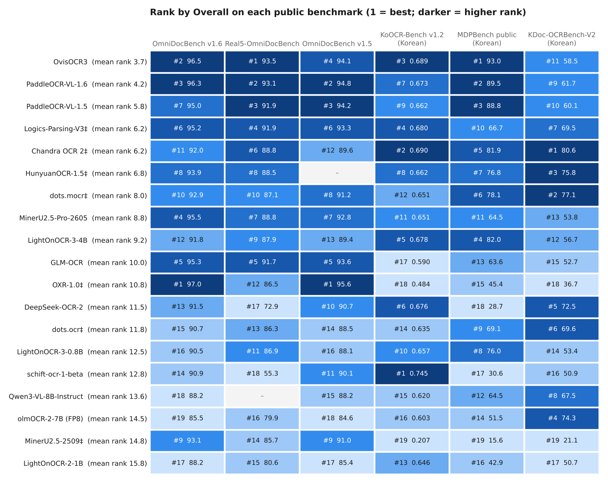
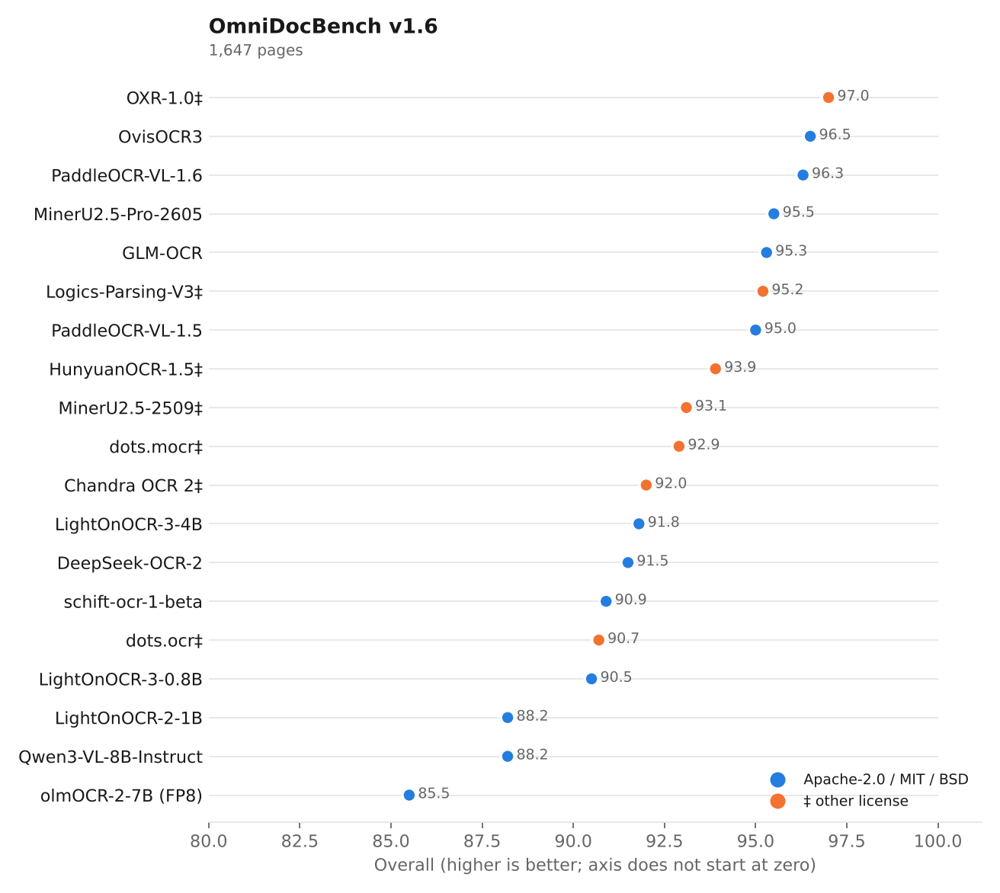
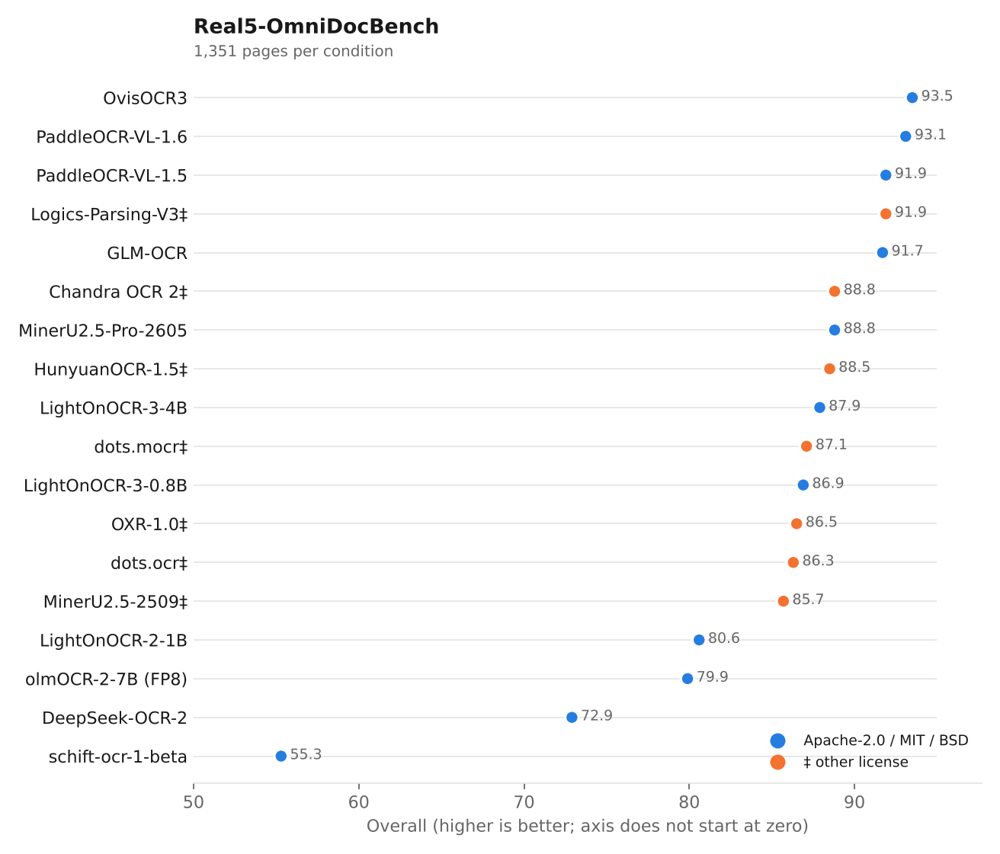
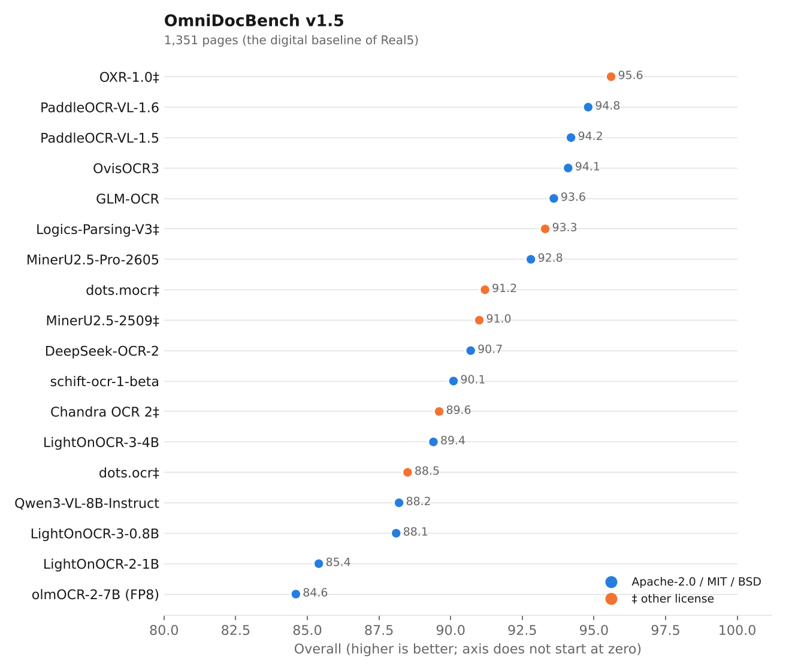
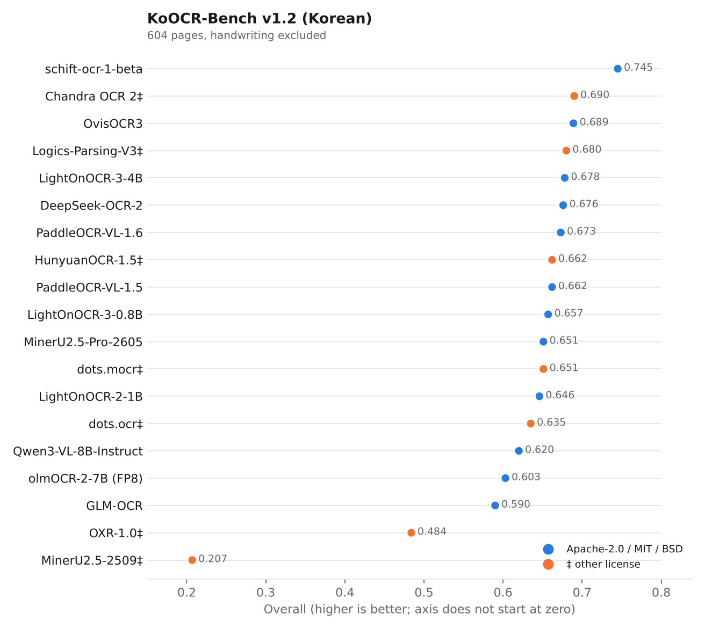
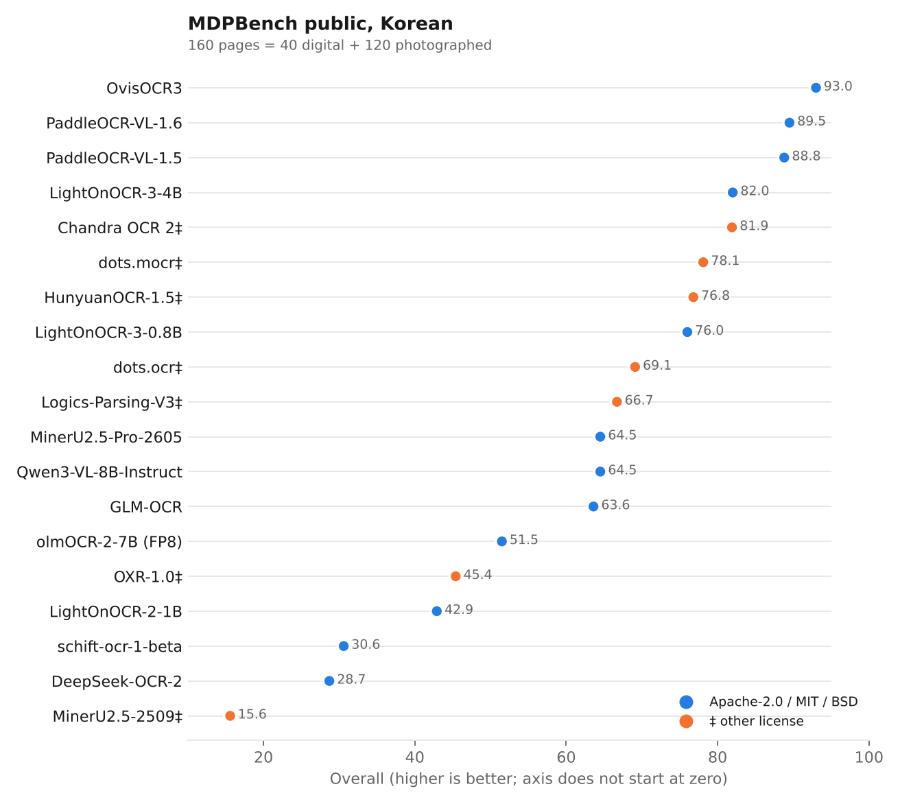
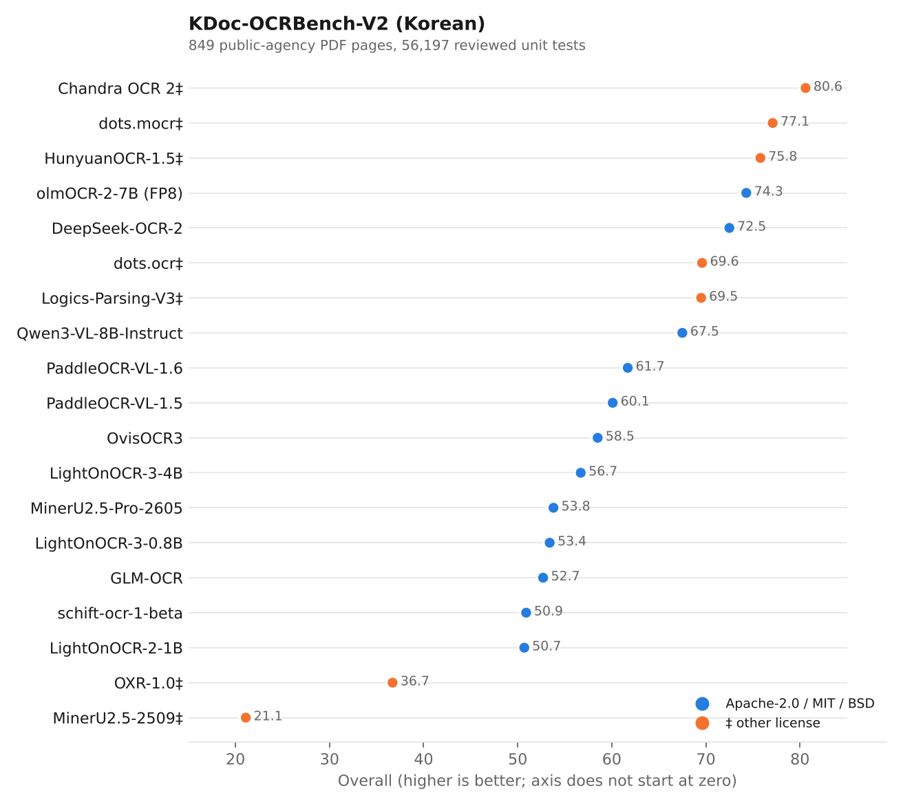

<!-- GENERATED by scripts/build_public_leaderboard.py from docs/results/public_leaderboard.yaml. Do not edit by hand. -->

# Public OCR and document-parsing benchmarks

Publicly released models on six public benchmarks, each scored with the benchmark's official scorer (run 2026-11-01). Three benchmarks are English/multilingual page parsing (OmniDocBench v1.6, its v1.5 baseline, and the Real5 capture conditions); three are Korean (KoOCR-Bench, MDPBench Korean, KDoc-OCRBench-V2).

How to read the tables:

- Rows are ordered by **Overall**. In every column the best value is **bold**; columns marked ↓ are lower-is-better.
- ‡ marks a license other than Apache-2.0, MIT or BSD (copyleft, a commercial-use threshold, a regional exclusion, extra usage terms, or no stated license). Check the terms before commercial use. These models are orange in the charts.
- *reported* is the score the model's authors published. It can differ from ours because of page subsets, settings, or scorer versions.
- A model missing from a table, or a cell shown as –, means the official scorer halted on that model's predictions.

## Across benchmarks

Models are ordered by their mean rank over the benchmarks they were scored on. Ranks are within this table, out of 19 models at most.

| Model | License | Benchmarks scored | Mean rank |
| --- | --- | ---: | ---: |
| OvisOCR3 | Apache-2.0 | 6 | 3.7 |
| PaddleOCR-VL-1.6 | Apache-2.0 | 6 | 4.2 |
| PaddleOCR-VL-1.5 | Apache-2.0 | 6 | 5.8 |
| Logics-Parsing-V3‡ | unspecified | 6 | 6.2 |
| Chandra OCR 2‡ | OpenRAIL-M (USD 2M threshold) | 6 | 6.2 |
| HunyuanOCR-1.5‡ | Tencent Hunyuan Community (excludes KR) | 5 | 6.8 |
| dots.mocr‡ | MIT + dots.ocr usage terms | 6 | 8.0 |
| MinerU2.5-Pro-2605 | Apache-2.0 | 6 | 8.8 |
| LightOnOCR-3-4B | Apache-2.0 | 6 | 9.2 |
| GLM-OCR | MIT | 6 | 10.0 |
| OXR-1.0‡ | OXR (Apache-2.0 + USD 2M commercial threshold) | 6 | 10.8 |
| DeepSeek-OCR-2 | Apache-2.0 | 6 | 11.5 |
| dots.ocr‡ | MIT + dots.ocr usage terms | 6 | 11.8 |
| LightOnOCR-3-0.8B | Apache-2.0 | 6 | 12.5 |
| schift-ocr-1-beta | MIT | 6 | 12.8 |
| Qwen3-VL-8B-Instruct | Apache-2.0 | 5 | 13.6 |
| olmOCR-2-7B (FP8) | Apache-2.0 | 6 | 14.5 |
| MinerU2.5-2509‡ | AGPL-3.0 | 6 | 14.8 |
| LightOnOCR-2-1B | Apache-2.0 | 6 | 15.8 |

## OmniDocBench v1.6

1,647 pages · official scorer, including CDM. Overall = ((1 − text Edit) × 100 + formula CDM + table TEDS) / 3. Four pages that could not be fetched were removed for every model; published numbers (`reported`) use all 1,651 pages.

| Model | Size (B) | License | Text Edit ↓ | Formula CDM | Table TEDS | Table TEDS-S | Reading-order Edit ↓ | Overall |
| --- | ---: | --- | ---: | ---: | ---: | ---: | ---: | ---: |
| OXR-1.0‡ | 1.5 | OXR (Apache-2.0 + USD 2M commercial threshold) | **0.025** | 96.8 | **96.6** | **98.4** | 0.122 | **97.0** |
| OvisOCR3 | 0.8 | Apache-2.0 | 0.026 | 97.2 | 95.0 | 97.4 | **0.114** | 96.5 |
| PaddleOCR-VL-1.6 | 1.0 | Apache-2.0 | 0.032 | **97.5** | 94.7 | 97.0 | 0.136 | 96.3 |
| MinerU2.5-Pro-2605 | 1.2 | Apache-2.0 | 0.037 | 96.8 | 93.4 | 96.0 | 0.124 | 95.5 |
| GLM-OCR | 1.3 | MIT | 0.038 | 96.4 | 93.5 | 96.0 | 0.140 | 95.3 |
| Logics-Parsing-V3‡ | 0.8 | unspecified | 0.037 | 96.1 | 93.3 | 95.9 | 0.125 | 95.2 |
| PaddleOCR-VL-1.5 | 1.0 | Apache-2.0 | 0.033 | 96.6 | 91.8 | 94.4 | 0.137 | 95.0 |
| HunyuanOCR-1.5‡ | 1.1 | Tencent Hunyuan Community (excludes KR) | 0.040 | 93.0 | 92.7 | 94.1 | 0.129 | 93.9 |
| MinerU2.5-2509‡ | 1.2 | AGPL-3.0 | 0.044 | 95.7 | 88.0 | 91.7 | 0.129 | 93.1 |
| dots.mocr‡ | 3.0 | MIT + dots.ocr usage terms | 0.039 | 92.7 | 89.9 | 93.0 | 0.129 | 92.9 |
| Chandra OCR 2‡ | 5.3 | OpenRAIL-M (USD 2M threshold) | 0.061 | 94.4 | 87.8 | 92.3 | 0.152 | 92.0 |
| LightOnOCR-3-4B | 4.5 | Apache-2.0 | 0.066 | 94.1 | 87.9 | 91.2 | 0.167 | 91.8 |
| DeepSeek-OCR-2 | 3.4 | Apache-2.0 | 0.050 | 93.6 | 86.0 | 89.4 | 0.145 | 91.5 |
| schift-ocr-1-beta | 3.6 | MIT | 0.067 | 92.5 | 86.8 | 89.8 | 0.150 | 90.9 |
| dots.ocr‡ | 3.0 | MIT + dots.ocr usage terms | 0.052 | 90.4 | 86.8 | 90.2 | 0.143 | 90.7 |
| LightOnOCR-3-0.8B | 0.8 | Apache-2.0 | 0.082 | 93.2 | 86.5 | 90.2 | 0.173 | 90.5 |
| LightOnOCR-2-1B | 1.0 | Apache-2.0 | 0.128 | 93.1 | 84.3 | 89.5 | 0.191 | 88.2 |
| Qwen3-VL-8B-Instruct | 8.8 | Apache-2.0 | 0.051 | 86.4 | 83.2 | 87.5 | 0.175 | 88.2 |
| olmOCR-2-7B (FP8) | 8.3 | Apache-2.0 | 0.106 | 89.4 | 77.8 | 82.3 | 0.203 | 85.5 |

Notes:

- OXR-1.0‡: reported 97.03
- OvisOCR3: reported 96.74 (self-reported)
- PaddleOCR-VL-1.6: reported 96.34
- MinerU2.5-Pro-2605: reported 95.72 (model card)
- GLM-OCR: reported 95.22 (cloud API)
- Logics-Parsing-V3‡: reported 95.58 (self-reported)
- PaddleOCR-VL-1.5: reported 94.93
- HunyuanOCR-1.5‡: reported 94.74 (paper)
- MinerU2.5-2509‡: reported 93.04
- DeepSeek-OCR-2: reported 90.25
- dots.ocr‡: reported 90.77 · 4 pages failed to predict (scored as empty)

## Real5-OmniDocBench

1,351 pages per condition · OmniDocBench v1.5 scorer. OmniDocBench v1.5 Overall per capture condition; Overall = mean of the five conditions. A model with a missing condition (the official scorer halted on its predictions) has no Overall.

| Model | Size (B) | License | Scanning | Warping | Screen-Photo | Illumination | Skew | Overall |
| --- | ---: | --- | ---: | ---: | ---: | ---: | ---: | ---: |
| OvisOCR3 | 0.8 | Apache-2.0 | 94.0 | **92.8** | **93.5** | **93.9** | **93.2** | **93.5** |
| PaddleOCR-VL-1.6 | 1.0 | Apache-2.0 | **94.5** | 92.6 | 92.6 | 93.2 | 92.5 | 93.1 |
| PaddleOCR-VL-1.5 | 1.0 | Apache-2.0 | 93.4 | 91.0 | 91.8 | 92.2 | 91.0 | 91.9 |
| Logics-Parsing-V3‡ | 0.8 | unspecified | 92.6 | 91.1 | 92.0 | 92.4 | 91.2 | 91.9 |
| GLM-OCR | 1.3 | MIT | 92.6 | 91.5 | 92.4 | 92.6 | 89.2 | 91.7 |
| Chandra OCR 2‡ | 5.3 | OpenRAIL-M (USD 2M threshold) | 89.2 | 89.0 | 88.7 | 89.3 | 88.0 | 88.8 |
| MinerU2.5-Pro-2605 | 1.2 | Apache-2.0 | 92.2 | 88.3 | 91.5 | 91.3 | 80.8 | 88.8 |
| HunyuanOCR-1.5‡ | 1.1 | Tencent Hunyuan Community (excludes KR) | 90.7 | 87.9 | 87.9 | 88.5 | 87.4 | 88.5 |
| LightOnOCR-3-4B | 4.5 | Apache-2.0 | 88.9 | 87.5 | 86.9 | 87.9 | 88.1 | 87.9 |
| dots.mocr‡ | 3.0 | MIT + dots.ocr usage terms | 89.0 | 86.2 | 87.3 | 89.7 | 83.3 | 87.1 |
| LightOnOCR-3-0.8B | 0.8 | Apache-2.0 | 87.3 | 87.0 | 86.0 | 87.2 | 87.2 | 86.9 |
| OXR-1.0‡ | 1.5 | OXR (Apache-2.0 + USD 2M commercial threshold) | 93.4 | 85.5 | 86.7 | 90.5 | 76.6 | 86.5 |
| dots.ocr‡ | 3.0 | MIT + dots.ocr usage terms | 86.8 | 85.6 | 87.4 | 87.5 | 83.9 | 86.3 |
| MinerU2.5-2509‡ | 1.2 | AGPL-3.0 | 89.9 | 84.0 | 89.4 | 89.5 | 75.7 | 85.7 |
| LightOnOCR-2-1B | 1.0 | Apache-2.0 | 85.1 | 77.5 | 79.5 | 80.6 | 80.2 | 80.6 |
| olmOCR-2-7B (FP8) | 8.3 | Apache-2.0 | 83.7 | 77.1 | 77.9 | 81.3 | 79.7 | 79.9 |
| DeepSeek-OCR-2 | 3.4 | Apache-2.0 | 89.4 | 65.6 | 71.3 | 76.2 | 62.0 | 72.9 |
| schift-ocr-1-beta | 3.6 | MIT | 85.8 | 45.3 | 51.2 | 55.6 | 38.8 | 55.3 |
| Qwen3-VL-8B-Instruct | 8.8 | Apache-2.0 | 87.0 | 87.8 | 85.9 | – | 86.3 | – |

Notes:

- OvisOCR3: reported 93.63 (self-reported)
- PaddleOCR-VL-1.6: reported 93.19
- PaddleOCR-VL-1.5: reported 92.05
- GLM-OCR: reported 90.32
- HunyuanOCR-1.5‡: reported 88.53
- dots.mocr‡: 3 pages failed to predict (scored as empty)
- dots.ocr‡: reported 86.38
- MinerU2.5-2509‡: reported 85.61
- DeepSeek-OCR-2: reported 73.01
- Qwen3-VL-8B-Instruct: official scorer halted on the Illumination predictions

## OmniDocBench v1.5

1,351 pages (the digital baseline of Real5) · OmniDocBench v1.5 scorer. The same pages scored with the v1.5 ground truth and scorer; Overall is defined as for v1.6. HunyuanOCR-1.5 is absent: the official scorer halted on its predictions.

| Model | Size (B) | License | Text Edit ↓ | Formula CDM | Table TEDS | Table TEDS-S | Reading-order Edit ↓ | Overall |
| --- | ---: | --- | ---: | ---: | ---: | ---: | ---: | ---: |
| OXR-1.0‡ | 1.5 | OXR (Apache-2.0 + USD 2M commercial threshold) | **0.025** | 93.3 | **95.8** | **98.3** | 0.033 | **95.6** |
| PaddleOCR-VL-1.6 | 1.0 | Apache-2.0 | 0.034 | 93.4 | 94.4 | 97.3 | 0.051 | 94.8 |
| PaddleOCR-VL-1.5 | 1.0 | Apache-2.0 | 0.034 | **93.5** | 92.7 | 95.7 | 0.052 | 94.2 |
| OvisOCR3 | 0.8 | Apache-2.0 | 0.028 | 90.7 | 94.5 | 97.3 | **0.025** | 94.1 |
| GLM-OCR | 1.3 | MIT | 0.043 | 91.0 | 94.1 | 96.7 | 0.058 | 93.6 |
| Logics-Parsing-V3‡ | 0.8 | unspecified | 0.040 | 90.7 | 93.2 | 96.0 | 0.041 | 93.3 |
| MinerU2.5-Pro-2605 | 1.2 | Apache-2.0 | 0.039 | 88.9 | 93.4 | 96.3 | 0.038 | 92.8 |
| dots.mocr‡ | 3.0 | MIT + dots.ocr usage terms | 0.035 | 87.1 | 89.9 | 93.4 | 0.038 | 91.2 |
| MinerU2.5-2509‡ | 1.2 | AGPL-3.0 | 0.045 | 89.0 | 88.5 | 92.7 | 0.043 | 91.0 |
| DeepSeek-OCR-2 | 3.4 | Apache-2.0 | 0.049 | 89.7 | 87.4 | 91.7 | 0.059 | 90.7 |
| schift-ocr-1-beta | 3.6 | MIT | 0.065 | 88.7 | 88.1 | 91.3 | 0.065 | 90.1 |
| Chandra OCR 2‡ | 5.3 | OpenRAIL-M (USD 2M threshold) | 0.065 | 87.5 | 87.8 | 93.1 | 0.067 | 89.6 |
| LightOnOCR-3-4B | 4.5 | Apache-2.0 | 0.075 | 88.4 | 87.4 | 91.7 | 0.079 | 89.4 |
| dots.ocr‡ | 3.0 | MIT + dots.ocr usage terms | 0.050 | 84.1 | 86.5 | 90.3 | 0.055 | 88.5 |
| Qwen3-VL-8B-Instruct | 8.8 | Apache-2.0 | 0.048 | 86.0 | 83.4 | 88.4 | 0.069 | 88.2 |
| LightOnOCR-3-0.8B | 0.8 | Apache-2.0 | 0.093 | 87.3 | 86.3 | 90.7 | 0.087 | 88.1 |
| LightOnOCR-2-1B | 1.0 | Apache-2.0 | 0.152 | 87.3 | 84.0 | 90.3 | 0.105 | 85.4 |
| olmOCR-2-7B (FP8) | 8.3 | Apache-2.0 | 0.111 | 87.2 | 77.8 | 82.2 | 0.111 | 84.6 |

Notes:

- PaddleOCR-VL-1.5: reported 94.50
- GLM-OCR: reported 94.35
- MinerU2.5-2509‡: reported 90.67
- DeepSeek-OCR-2: reported 89.17
- dots.ocr‡: reported 88.41 · 4 pages failed to predict (scored as empty)

## KoOCR-Bench v1.2 (Korean)

604 pages, handwriting excluded · official weighted sum. Official weighted sum. The Boxes item only checks whether boxes are emitted, so any box-less markdown output scores 0 there; "Excl. boxes" is shown alongside for that reason.

| Model | Size (B) | License | Excl. boxes | Excl. user_real | Gazette | Statistical tables | KDI | Policy tables | user_real | CSAT | Titles | Order | Grid | Boxes | Overall |
| --- | ---: | --- | ---: | ---: | ---: | ---: | ---: | ---: | ---: | ---: | ---: | ---: | ---: | ---: | ---: |
| schift-ocr-1-beta | 3.6 | MIT | 0.726 | **0.782** | 0.888 | 0.737 | 0.900 | **0.643** | 0.448 | 0.673 | 0.693 | 0.875 | 0.095 | **0.938** | **0.745** |
| Chandra OCR 2‡ | 5.3 | OpenRAIL-M (USD 2M threshold) | **0.757** | 0.720 | 0.915 | 0.751 | 0.939 | 0.621 | 0.457 | 0.744 | **0.911** | 0.938 | 0.120 | 0.000 | 0.690 |
| OvisOCR3 | 0.8 | Apache-2.0 | 0.755 | 0.710 | **0.932** | 0.764 | 0.903 | 0.610 | 0.519 | 0.736 | 0.837 | 0.868 | 0.130 | 0.000 | 0.689 |
| Logics-Parsing-V3‡ | 0.8 | unspecified | 0.746 | 0.705 | 0.911 | 0.745 | 0.922 | 0.642 | 0.484 | 0.754 | 0.639 | 0.922 | 0.150 | 0.000 | 0.680 |
| LightOnOCR-3-4B | 4.5 | Apache-2.0 | 0.744 | 0.700 | 0.918 | 0.747 | 0.903 | 0.592 | 0.507 | 0.698 | 0.881 | 0.865 | 0.085 | 0.000 | 0.678 |
| DeepSeek-OCR-2 | 3.4 | Apache-2.0 | 0.692 | 0.701 | 0.837 | 0.703 | 0.863 | 0.534 | 0.478 | 0.722 | 0.579 | 0.920 | 0.070 | 0.512 | 0.676 |
| PaddleOCR-VL-1.6 | 1.0 | Apache-2.0 | 0.738 | 0.696 | 0.885 | 0.740 | 0.903 | 0.623 | 0.486 | 0.668 | 0.881 | 0.860 | 0.145 | 0.000 | 0.673 |
| HunyuanOCR-1.5‡ | 1.1 | Tencent Hunyuan Community (excludes KR) | 0.726 | 0.683 | 0.898 | 0.695 | 0.913 | 0.545 | 0.492 | 0.692 | **0.911** | 0.922 | 0.060 | 0.000 | 0.662 |
| PaddleOCR-VL-1.5 | 1.0 | Apache-2.0 | 0.726 | 0.685 | 0.877 | 0.707 | 0.903 | 0.614 | 0.479 | 0.653 | 0.881 | 0.864 | 0.135 | 0.000 | 0.662 |
| LightOnOCR-3-0.8B | 0.8 | Apache-2.0 | 0.720 | 0.673 | 0.891 | 0.743 | 0.898 | 0.522 | **0.528** | 0.681 | 0.728 | 0.862 | 0.050 | 0.000 | 0.657 |
| MinerU2.5-Pro-2605 | 1.2 | Apache-2.0 | 0.714 | 0.671 | 0.914 | **0.768** | 0.903 | 0.640 | 0.496 | 0.726 | 0.000 | 0.868 | **0.155** | 0.000 | 0.651 |
| dots.mocr‡ | 3.0 | MIT + dots.ocr usage terms | 0.714 | 0.670 | 0.899 | 0.740 | 0.936 | 0.582 | 0.499 | **0.773** | 0.134 | **0.941** | 0.075 | 0.000 | 0.651 |
| LightOnOCR-2-1B | 1.0 | Apache-2.0 | 0.709 | 0.664 | 0.885 | 0.743 | 0.898 | 0.577 | 0.500 | 0.647 | 0.460 | 0.855 | 0.070 | 0.000 | 0.646 |
| dots.ocr‡ | 3.0 | MIT + dots.ocr usage terms | 0.697 | 0.651 | 0.856 | 0.732 | 0.910 | 0.549 | 0.509 | 0.659 | 0.282 | 0.932 | 0.055 | 0.000 | 0.635 |
| Qwen3-VL-8B-Instruct | 8.8 | Apache-2.0 | 0.680 | 0.633 | 0.899 | 0.692 | 0.911 | 0.528 | 0.515 | 0.712 | 0.010 | 0.875 | 0.065 | 0.000 | 0.620 |
| olmOCR-2-7B (FP8) | 8.3 | Apache-2.0 | 0.661 | 0.614 | 0.807 | 0.677 | **0.945** | 0.497 | 0.514 | 0.678 | 0.000 | 0.928 | 0.040 | 0.000 | 0.603 |
| GLM-OCR | 1.3 | MIT | 0.647 | 0.618 | 0.790 | 0.738 | 0.788 | 0.608 | 0.372 | 0.570 | 0.104 | 0.911 | 0.135 | 0.000 | 0.590 |
| OXR-1.0‡ | 1.5 | OXR (Apache-2.0 + USD 2M commercial threshold) | 0.531 | 0.514 | 0.574 | 0.714 | 0.573 | 0.525 | 0.241 | 0.325 | 0.144 | 0.915 | 0.115 | 0.000 | 0.484 |
| MinerU2.5-2509‡ | 1.2 | AGPL-3.0 | 0.227 | 0.233 | 0.228 | 0.404 | 0.008 | 0.251 | 0.006 | 0.098 | 0.000 | 0.855 | 0.115 | 0.000 | 0.207 |

Notes:

- schift-ocr-1-beta: reported 0.7551 (private checkpoint)
- PaddleOCR-VL-1.6: reported 0.7483 (bbox override)

## MDPBench public, Korean

160 pages = 40 digital + 120 photographed · official calculate_scores. Per page, the mean of the text, formula and table scores; then the page mean × 100. The published Korean numbers (`reported`) are the authors' runs; our PaddleOCR-VL run with the same scoring code is about 3 points higher, so compare models within this table.

| Model | Size (B) | License | Digital | Photographed | Overall |
| --- | ---: | --- | ---: | ---: | ---: |
| OvisOCR3 | 0.8 | Apache-2.0 | **97.4** | **91.6** | **93.0** |
| PaddleOCR-VL-1.6 | 1.0 | Apache-2.0 | 94.7 | 87.7 | 89.5 |
| PaddleOCR-VL-1.5 | 1.0 | Apache-2.0 | 93.8 | 87.1 | 88.8 |
| LightOnOCR-3-4B | 4.5 | Apache-2.0 | 93.4 | 78.2 | 82.0 |
| Chandra OCR 2‡ | 5.3 | OpenRAIL-M (USD 2M threshold) | 94.6 | 77.7 | 81.9 |
| dots.mocr‡ | 3.0 | MIT + dots.ocr usage terms | 91.9 | 73.4 | 78.1 |
| HunyuanOCR-1.5‡ | 1.1 | Tencent Hunyuan Community (excludes KR) | 94.8 | 70.7 | 76.8 |
| LightOnOCR-3-0.8B | 0.8 | Apache-2.0 | 90.4 | 71.2 | 76.0 |
| dots.ocr‡ | 3.0 | MIT + dots.ocr usage terms | 91.0 | 61.6 | 69.1 |
| Logics-Parsing-V3‡ | 0.8 | unspecified | 92.2 | 58.0 | 66.7 |
| MinerU2.5-Pro-2605 | 1.2 | Apache-2.0 | 96.3 | 53.6 | 64.5 |
| Qwen3-VL-8B-Instruct | 8.8 | Apache-2.0 | 94.5 | 54.5 | 64.5 |
| GLM-OCR | 1.3 | MIT | 84.2 | 56.7 | 63.6 |
| olmOCR-2-7B (FP8) | 8.3 | Apache-2.0 | 80.8 | 41.7 | 51.5 |
| OXR-1.0‡ | 1.5 | OXR (Apache-2.0 + USD 2M commercial threshold) | 57.9 | 41.2 | 45.4 |
| LightOnOCR-2-1B | 1.0 | Apache-2.0 | 80.8 | 30.0 | 42.9 |
| schift-ocr-1-beta | 3.6 | MIT | 86.0 | 12.2 | 30.6 |
| DeepSeek-OCR-2 | 3.4 | Apache-2.0 | 82.6 | 10.8 | 28.7 |
| MinerU2.5-2509‡ | 1.2 | AGPL-3.0 | 22.7 | 13.2 | 15.6 |

Notes:

- PaddleOCR-VL-1.6: reported 86.3
- PaddleOCR-VL-1.5: reported 86.0
- Chandra OCR 2‡: reported 80.3
- dots.mocr‡: reported 78.7
- HunyuanOCR-1.5‡: reported 75.7
- dots.ocr‡: reported 68.5
- MinerU2.5-Pro-2605: reported 77.6
- Qwen3-VL-8B-Instruct: reported 61.9
- GLM-OCR: reported 61.2
- olmOCR-2-7B (FP8): reported 70.6
- LightOnOCR-2-1B: reported 41.9
- MinerU2.5-2509‡: reported 14.7

## KDoc-OCRBench-V2 (Korean)

849 public-agency PDF pages, 56,197 reviewed unit tests · official olmOCR-bench Average Score. Mean over test files of the per-file pass rate. Baseline is the test the scorer adds per page (empty output, trailing repetition, or any Han/kana/emoji fails it, so transcribing Hanja faithfully also fails). Every model got the same 200-DPI rendering of each PDF. The official scorer drops a model's whole score if one test raises; the table parser raises on overlapping rowspans, so those tests were counted as failed instead (row notes). Published card numbers (rendering and settings not disclosed): PaddleOCR-VL 77.7 · DeepSeek-OCR 76.7 · olmOCR v0.2.0 76.3 · GLM-OCR 61.7.

| Model | Size (B) | License | Baseline | No header/footer | Body text | Tables | Overall |
| --- | ---: | --- | ---: | ---: | ---: | ---: | ---: |
| Chandra OCR 2‡ | 5.3 | OpenRAIL-M (USD 2M threshold) | 95.1 | 95.5 | 80.4 | 51.4 | **80.6** |
| dots.mocr‡ | 3.0 | MIT + dots.ocr usage terms | 85.4 | 95.2 | 79.0 | 48.9 | 77.1 |
| HunyuanOCR-1.5‡ | 1.1 | Tencent Hunyuan Community (excludes KR) | 94.9 | 91.2 | 78.3 | 38.8 | 75.8 |
| olmOCR-2-7B (FP8) | 8.3 | Apache-2.0 | **95.8** | 94.9 | 68.1 | 38.3 | 74.3 |
| DeepSeek-OCR-2 | 3.4 | Apache-2.0 | 94.6 | 96.1 | 65.7 | 33.6 | 72.5 |
| dots.ocr‡ | 3.0 | MIT + dots.ocr usage terms | 77.6 | 94.9 | 65.8 | 39.9 | 69.6 |
| Logics-Parsing-V3‡ | 0.8 | unspecified | 86.9 | 95.3 | 55.1 | 40.5 | 69.5 |
| Qwen3-VL-8B-Instruct | 8.8 | Apache-2.0 | 93.1 | 44.8 | 81.1 | 50.9 | 67.5 |
| PaddleOCR-VL-1.6 | 1.0 | Apache-2.0 | 94.7 | 38.0 | 70.4 | 43.8 | 61.7 |
| PaddleOCR-VL-1.5 | 1.0 | Apache-2.0 | 94.1 | 37.9 | 69.1 | 39.2 | 60.1 |
| OvisOCR3 | 0.8 | Apache-2.0 | 91.9 | 5.7 | **85.0** | **51.7** | 58.5 |
| LightOnOCR-3-4B | 4.5 | Apache-2.0 | 94.1 | 7.1 | 77.3 | 48.4 | 56.7 |
| MinerU2.5-Pro-2605 | 1.2 | Apache-2.0 | 87.4 | 8.1 | 75.1 | 44.4 | 53.8 |
| LightOnOCR-3-0.8B | 0.8 | Apache-2.0 | 94.6 | 8.0 | 67.9 | 43.2 | 53.4 |
| GLM-OCR | 1.3 | MIT | 63.4 | 96.8 | 24.7 | 25.8 | 52.7 |
| schift-ocr-1-beta | 3.6 | MIT | 87.6 | 15.2 | 66.6 | 34.2 | 50.9 |
| LightOnOCR-2-1B | 1.0 | Apache-2.0 | 94.9 | 9.5 | 62.0 | 36.3 | 50.7 |
| OXR-1.0‡ | 1.5 | OXR (Apache-2.0 + USD 2M commercial threshold) | 4.2 | **97.3** | 22.4 | 23.0 | 36.7 |
| MinerU2.5-2509‡ | 1.2 | AGPL-3.0 | 0.5 | 73.1 | 3.7 | 7.1 | 21.1 |

Notes:

- dots.mocr‡: 101 tests where the scorer raised counted as failed
- Logics-Parsing-V3‡: 3 tests where the scorer raised counted as failed
- GLM-OCR: reported 61.7 (settings not disclosed) · 246 tests where the scorer raised counted as failed
- OXR-1.0‡: 45 tests where the scorer raised counted as failed

---

Regenerate with `python scripts/build_public_leaderboard.py` (needs the `report` extra for matplotlib).
