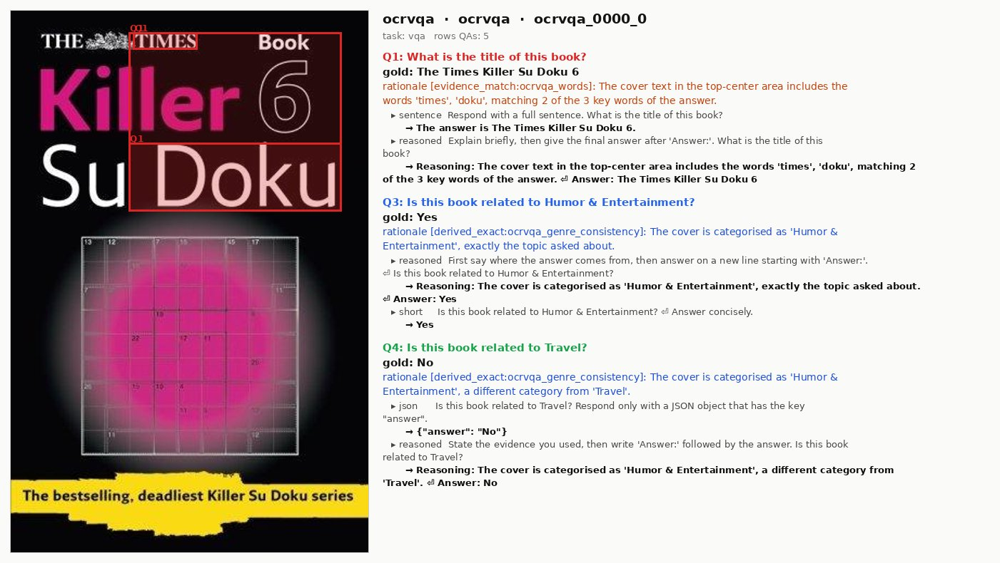
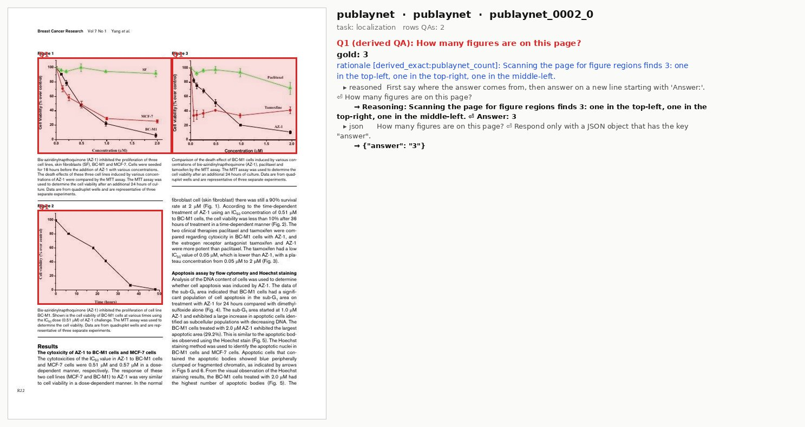
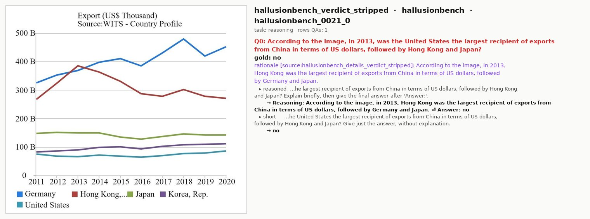

# UDD anomaly catalogue: what goes wrong in public benchmark rows, and how often

Deriving rationales and instruction/answer variants over UDD
([`benchmark_reasoning_extraction.md`](benchmark_reasoning_extraction.md)) surfaced many ways a row
can be "strange". The gold may not be the answer, a box may sit in the wrong frame, a label may mean
something other than what a question assumes, a source rationale may contradict its own gold, a
prompt clause may conflict with a new format, or a number may be written in a notation a naive
parser misreads.

This catalogue lists every such case with a **detector**. Each detector is a pure function over a
UDD row in `src/docvlm_eval/unified/anomalies.py`. `scripts/audit_udd_anomalies.py` runs them all,
so the counts below are measured on the full corpus (39,837 rows), not estimated.

```bash
python scripts/audit_udd_anomalies.py --from-hub     # -> docs/results/udd_anomalies.{json,md}
```

## Overview

| family | cases | hits | what goes wrong |
| --- | ---: | ---: | --- |
| **gold** | 4 | 26,570 | the scored gold is not the answer the image supports |
| **geometry** | 3 | 3,458 | boxes in the wrong frame, or evidence words that recur or are missing |
| **convention** | 3 | 622 | a label or a table means something other than the question assumes |
| **rationale** | 4 | 252 | source rationales that restate, contradict, or are plans rather than evidence |
| **instruction** | 3 | 20,628 | prompt clauses that conflict with a new format, or that are not what they look like |
| **number** | 4 | 196 | notations a naive parser reads wrongly |

Status of the 21 cases:

- **12 fixed in the derived data.** The derived rows and variants are correct today.
- **1 fixed in the loader.** It takes effect when UDD is rebuilt.
- **5 gated.** Detected, and no rationale or variant is produced.
- **3 skipped by design.** That question type is not derived where the case occurs.

## How the cases were found

Not every case shows up the same way. This is why the work used several kinds of checks:

| found by | cases |
| --- | --- |
| scanning all golds and instructions | G1, G2, I1 |
| reading the generated preview | G4, I2, B1 (a grounded target with a coordinate > 1000) |
| **rendering rationales on the real images** | **G3, B2, C1, R2** |
| random audit of rationales per deriver | R3, N2, N3 |
| the quality gate's rejection reasons | R1 |
| unit tests | N4 |
| building this catalogue (checking each detector's examples) | R4, I3 |
| designed in from the start | B3, C2, C3, N1 |

Four cases only became visible once the evidence was drawn on the image. The text of their
rationales looked plausible.

## gold: the scored gold is not the answer

| id | case | example | hits | why it matters | handling | status |
| --- | --- | --- | ---: | --- | --- | --- |
| G1 | Derivation embedded in the gold | TAT-QA `"74.5-26.0\nAnswer: 48.5."` | 3,057 (tatqa 3,051, docmatix 6) | a correct `48.5` scores as wrong | split at `Answer:`; the derivation becomes the rationale and the gold is repaired | fixed (derived) |
| G2 | Stray trailing period on a short gold | DVQA `"Mean."` (100% of DVQA/PlotQA) | 23,076 | exact match fails, and models learn to emit the period | canonical gold without it; the original kept as a variant | fixed (derived) |
| G3 | Markdown heading marks in title text | OmniDocBench `# Suitability of Cubic Splines` | 351 | a derived title gold asks for a `#` that is not on the page | leading `#` stripped from derived golds | fixed (derived) |
| G4 | Abstain token as the gold | ScreenQA `<no answer>` | 86 | re-rendered as a sentence or JSON, it teaches inventing a value | abstain golds keep only their original form | gated |

## geometry: boxes and evidence positions

| id | case | example | hits | why it matters | handling | status |
| --- | --- | --- | ---: | --- | --- | --- |
| B1 | Pixel box in the pre-resize frame | CORD `[672, 652, 746, 678]` on a 667×1000 image | 2,078 (screenqa 1,163, cord 915) | the build resized images to ≤1000 px but kept pixel boxes, so every pixel box is mis-scaled (these are the ones visibly off-image) | `normalize_pixel_boxes()` before resizing; rationales ignore pixel boxes until the rebuild | fixed (loader) |
| B2 | Answer word recurs far from the title | OCR-VQA "doku" in the title (y=0.31) and a tagline (y=0.90) | 151 | the evidence box spans the whole cover and "center area" is wrong | nearest occurrence to the largest hit; ignore matches more than 40% away | fixed (derived) |
| B3 | Title/author missing from the cover OCR | OCR-VQA "Collins UK" | 1,229 | any evidence would be invented | no rationale under 60% key-word coverage | gated |



## convention: labels that mean something else

| id | case | example | hits | why it matters | handling | status |
| --- | --- | --- | ---: | --- | --- | --- |
| C1 | PubLayNet `Title` also labels figure tags | "Figure 1" above a plot is a `Title` region | 43 detected on figures (lower bound) | "how many titles?" gets 6 where a reader counts 2–3 | title counts not asked for PubLayNet (1,073 QAs not generated) | skipped |
| C2 | Table with merged cells | PubTabNet `colspan="2"` headers | 575 | a (row, column) lookup reads the wrong cell under a spanning header | cell lookups only on span-free tables | skipped |
| C3 | Receipt amounts that do not add up | CORD Σ lines 171,000 ≠ subtotal 85,500 | 4 | a rationale would assert arithmetic the receipt does not satisfy | arithmetic QAs only when the relation holds | skipped |



## rationale: source rationales that are not evidence

| id | case | example | hits | why it matters | handling | status |
| --- | --- | --- | ---: | --- | --- | --- |
| R1 | Restates the question | HallusionBench "Yes. … Asian families have the highest …" | 125 | a `Reasoning:` target with no evidence teaches paraphrase, not looking | rejected by the gate, moved to `reasoning_rejected` | gated |
| R2 | Opens with the *paired* question's verdict | "Yes. In 2013, Hong Kong was the largest …" under gold "no" | 3 | trains a self-contradicting chain; the statement after the verdict is correct for the image | leading verdict stripped, rest re-gated | fixed (derived) |
| R3 | Derivation text without values | TAT-QA "Obtained from the table" | 15 | cites nothing on the page | dropped as a rationale; gold still repaired | gated |
| R4 | Count derivation with `##` separators | TAT-QA `Kefir ## Cheese ## Cream and other …` → 6 | 109 | splitting on `,` or "and" miscounts, so 109 valid counts were being dropped | split on `##` (else `;`/`,`, never "and"), then verify the count | fixed (derived) |



## instruction: prompt clauses that conflict or mislead

| id | case | example | hits | why it matters | handling | status |
| --- | --- | --- | ---: | --- | --- | --- |
| I1 | Brevity suffix conflicting with a new format | the_cauldron "Offer a terse response." (18 variants) | 17,003 | "terse" plus "full sentence" is an impossible instruction | suffixes stripped before a new clause is attached | fixed (derived) |
| I2 | Non-English question | MTVQA 「診療時間は何時からですか」 | 3,424 | "The answer is 午前9時…" mixes languages in the target | English sentence templates only for English questions | gated |
| I3 | Unnumbered inline option list | OCRBench v2 "Here's some options: christmas, valentine, …" | 201 | parsed as `Options:`, the sentence tail becomes one fake option | only a line-initial `Options:` list counts | fixed (derived) |

## number: notations a naive parser misreads

| id | case | example | hits | why it matters | handling | status |
| --- | --- | --- | ---: | --- | --- | --- |
| N1 | Dot as thousands separator | CORD `60.000` (Indonesian receipts) | 171 | read as 60.0, receipt arithmetic is wrong | 3-digit dot groups are thousands for receipts | fixed (derived) |
| N2 | Accounting negative | TAT-QA `7,572 - (6,919)` = 14,491 | 5 | read as +6,919 the result is 653, and a correct derivation is rejected | a parenthesized bare number is negative | fixed (derived) |
| N3 | Percent as a fraction | TAT-QA `65% * 3,433` = 2,231.45 | 10 | dropping `%` gives 223,145 | both readings tried; the one matching the gold is kept | fixed (derived) |
| N4 | Leading-zero 3-decimal number | `0.039` | 10 | a thousands rule reads it as 39 | thousands groups must start with a non-zero digit | fixed (derived) |

## What this changes in practice

1. **Repairs in the derived data are not yet in the Hub dataset.** G1/G2 golds are corrected in
   `examples/udd_reasoning/rows.jsonl`. Publishing them, plus the B1 loader fix and majority-first
   golds, needs a UDD rebuild.
2. **Gates trade recall for honesty.** B3, R1, R3 and I2 cost about 4,800 potential rationales or
   variants. Each one would have taught something false or empty.
3. **Treat new sources the same way.** Before deriving anything from a new benchmark, run the audit,
   render ten rationales on their images, and read one random sample per deriver. Every case above
   was found by exactly one of these.
